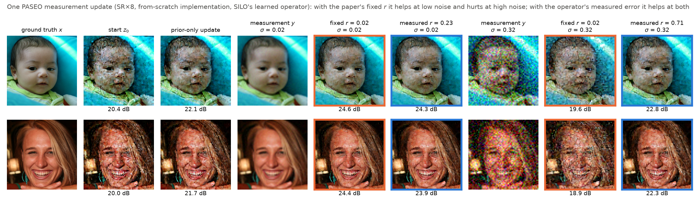
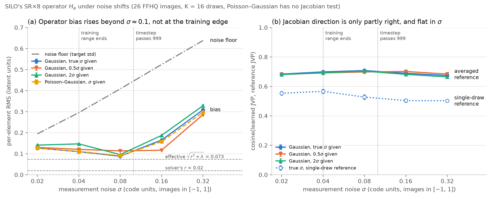
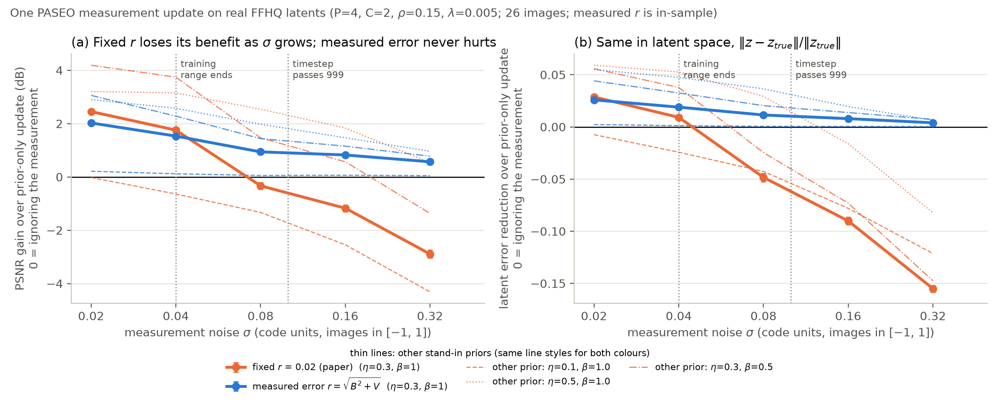

# PASEO's measurement correction, from scratch

*When does a fixed trust in the learned operator break?*



**Figure 1.** One PASEO measurement update on real FFHQ latents (super-resolution ×8).
With the paper's fixed operator noise *r* = 0.02, the update helps at the paper's noise level (σ = 0.02) and
hurts at σ = 0.32, compared with ignoring the measurement ("prior-only"). With *r* set to the operator's
**measured** error, it helps at both. These are *not* reconstructions: z₀ is a deliberately noisy stand-in for
a diffusion state, and one update moves only part of the way ([Section 4](#4-one-step-correction-on-real-latents)).
First two FFHQ images, not selected.

This is an **unofficial, partial implementation** of
[**PASEO** (Perturb-and-Solve)](https://arxiv.org/abs/2609.33171) by Shtanchaev et al., tested on the released
operator of [**SILO**](https://arxiv.org/abs/2501.11746) by Raphaeli et al. The method is theirs; this
repository adds an independent implementation and a stress test. It is not affiliated with either group.
See [Credits](#credits).

## Summary

PASEO conditions a latent diffusion model on a measurement by repeatedly solving a small linear system built
from a learned latent operator *H*ψ, its Jacobian (used only through JVP / VJP) and a fixed operator-noise
level *r*. This repository:

1. **implements the correction step** (matrix-free conjugate gradients) and checks it against a closed-form posterior;
2. **repeats the paper's operator check (Table 5)**: value error 0.157 (paper 0.16), but a different Jacobian norm;
3. **stress-tests the operator**: stronger noise, wrong σ, Poisson–Gaussian noise;
4. **runs one update on real latents** with the fixed *r* and with the operator's measured error.

**Main findings** (26 images, SILO's released operator; see [Caveats](#caveats)):

- **Fixed *r* loses its benefit as noise grows**; its latent error becomes worse than prior-only in every setting,
  earlier for narrower priors. With the
  measured *r*, one update improved PSNR in all 520 image × prior × σ cases (*r* measured on the same images).
- **The operator's bias rises to 2.4× its σ = 0.02 value** at σ = 0.32. Its noise conditioning is a likely cause:
  at σ = 0.16, feeding it the *wrong*, in-range σ = 0.08 lowers the bias by 29 %.
- **Its Jacobian direction is only partly right at every noise level**, including the paper's
  (cosine ≈ 0.5–0.7).

Units: σ is the noise standard deviation on images in [−1, 1]. σ = 0.02 is the paper's σ_y = 0.01; SILO's
operator was trained within σ ∈ [0, 0.04].

---

## 1. The correction step is correct (linear-Gaussian toy)

PASEO's step perturbs the prior and the measurement, then solves
((r² + λ) I + η² J Jᵀ) v = b and sets z\* = z_a + η² Jᵀ v. For a linear operator this gives exact posterior
samples. `toy_linear_gaussian.py` checks this with a random 10 × 20 matrix and 10,000 samples.

| check | result |
|---|---|
| CG + JVP/VJP (C = m iterations) vs direct solve, same random draws | max difference **8.9e-16** |
| sample mean / covariance error, exact solve, λ = 0 | 0.0030 / 0.032, at the Monte-Carlo floor (0.0026 / 0.039) |
| same without perturbing the measurement | covariance error 0.093: samples too narrow |
| λ = 0.005 alone (converged CG) | mean error 0.0148 (closed form: 0.0142) |
| C = 2 CG iterations, as in the paper | mean error 0.069 |

Stopping CG after C = 2 iterations moves the step further from an exact posterior sample than λ does; the
paper uses this truncation on purpose as a regulariser (§3, citing Hanke 1995).

## 2. Reproducing the paper's operator check (Table 5, RV-v5.1, SR ×8)

`operator_diagnostics.py`: reference = the true chain ℰ(𝒜(𝒟(z))), z = ℰ(x), 26 images × 4 random
directions, true fp32 (TF32 off; with it on, the adjoint check is 1000× worse).

| metric | this repo | paper |
|---|---|---|
| value RMS error | **0.157** ± 0.021 | 0.16 |
| value error ÷ *r* (0.02) | 7.9× | 8.0× |
| direction cosine (finite-difference step 1e-3 to 1e-2) | 0.50–0.53 | 0.59 |
| magnitude error | 0.49–0.52 | 0.46 |
| adjoint error | 1.4e-6 | 7e-7 |
| ‖J‖₂ (power iteration, converged) | **3.8** ± 0.9 | 12.2 |

Values match, directions roughly match, but the Jacobian norm is 3× smaller. Together with the parameter
count (3.55 M here vs 1.2 M in the paper), this suggests PASEO used its own retrained operator. Two operators
with the same value error and very different Jacobians is itself a hint that fitting values does not pin down
the derivative the solver relies on. The cosine depends on the finite-difference step (0.73 at step 0.1); I
report the small-step value, where the reference is self-consistent (cosine 0.994 between steps 1e-3 and 3e-3).

## 3. The operator under noise shifts



`operator_noise_study.py`: for each image and σ, K = 16 noisy targets F_k give the target mean F̄ and the
**noise floor** V̂ (what no predictor can remove); the operator's squared **bias** is
B̂² = ‖H − F̄‖² − V̂/K, corrected for the noise in F̄. Monte-Carlo error on B² is 1–6 %, and B̂² + V̂ matches
the total error to 3 decimals in every cell. Same images, directions and noise draws at every σ.

- **(a) Bias** stays flat or falls through σ = 0.08 (twice the training range), then rises to 2.4× at
  σ = 0.32, in every image. The upturn sits where SILO's noise embedding, the diffusion timestep
  t = σ / 0.1 × 999, passes 999. At σ = 0.16 the wrong in-range σ = 0.08 gives 29 % less bias than the
  true σ (100 % of images). Within the training range, a wrong σ costs +3 % to +34 %, more when σ is
  overestimated.
- **Poisson–Gaussian noise** (half shot noise, half read noise, same average variance; 34 photons at
  intensity 1 at σ = 0.32) gave **no** extra bias over Gaussian noise, averaged over the image.
- **(b) Jacobian direction** is flat in σ and in the σ given: cosine ≈ 0.68 against a reference averaged
  over 4 noise draws, ≈ 0.50–0.57 against a single draw. The misalignment is already there at the paper's
  setting; noise shift does not make it worse.

## 4. One-step correction on real latents



`one_step_experiment.py`: without a diffusion model, a calibrated stand-in prior replaces it:
μ = z_true + η δ, start z₀ = μ + η w′, measurement y_z = ℰ(up(𝒜(x) + σ ε)). One PASEO update with the
paper's SR ×8 settings (P = 4 corrections, C = 2 CG iterations, ρ = 0.15, λ = 0.005, arc anchor β), with
*r* = 0.02 (paper) or *r* = √(B² + V) measured in Section 3. The baseline is the **same update with the
measurement ignored** (r → ∞), not z₀: relaxing towards the anchor already averages out some prior noise
(error 0.471 → 0.408 with no measurement at all).

- **Fixed r**: the gain falls with σ for every prior, and latent error is worse than prior-only from some σ on:
  from σ = 0.02 at η = 0.1, 0.08 at η = 0.3 and 0.16 at η = 0.5 (where PSNR still gains).
- **Measured r**: PSNR improves in 520/520 cases and latent error in 519/520.
- At low noise the tuned fixed *r* is slightly better in the main setting (η = 0.3, β = 1): +2.45 vs +2.02 dB at σ = 0.02.
- In the main setting the fixed-*r* damage starts at σ = 0.08, where the operator's bias is at its **lowest**: the
  problem is not only operator error but the measurement noise as it appears in latent space (noise floor 0.41
  vs *r* = 0.02).

## Caveats

- **Operator.** SILO's released `sr_8_cnn_ffhq_operator.pt` (3.55 M parameters), most likely not the one in
  the paper (1.2 M, ‖J‖₂ 12.2 vs 3.8 here). Whether it was trained on σ ~ U(0, 0.04) or a fixed σ is not
  documented.
- **Not a sampler.** Section 4 is one update from a stand-in prior, not PASEO's 28-step sampling; no LPIPS.
  PSNR and latent error can disagree for the fixed *r* at mid σ.
- **In-sample r.** The measured *r* is one scalar per σ, estimated on the same 26 images, from the chain
  through 𝒟(z). It is an oracle calibration; estimating it without the truth is the open question.
- **Small data.** The 26 FFHQ images shipped with SILO; the Jacobian reference depends on the number of
  noise draws averaged (both versions reported). Poisson–Gaussian has no Jacobian test (a Poisson draw is not
  differentiable in z) and only an image-averaged bias.
- **Choices the paper leaves open**: no noise in the Table 5 reference; Gaussian random directions;
  VAE mean encoding (SILO trained with samples); finite-difference steps as listed above.

## What I would do next

1. **Calibrated trust instead of a fixed r.** The scalar measured error already removed almost all the harm in Section 4.
   Next: let the operator predict a per-element error r_ψ(z, σ), trained with a Gaussian likelihood on noisy
   targets so it covers both bias and noise floor, and use S = diag(r_ψ²) + λI + η² J Jᵀ (still symmetric
   positive definite, still matrix-free). Test it in the full sampler with LPIPS, including whether the
   fixed *r* hurts first in late steps, where the prior is narrow.
2. **Noise conditioning that extrapolates.** Replace the reused timestep embedding with one designed for the
   σ range and train over a wider range and over unknown σ; check that the bias stops rising beyond σ ≈ 0.1.
   Look for spatial bias under Poisson noise (bright regions) rather than an image average.
3. **Jacobian-aware operator training.** Add a directional-derivative loss (Sobolev-style) to the value loss and
   measure whether the cosine rises above ≈ 0.6 and whether PASEO's reconstructions improve, especially on
   JPEG, where the paper reports a cosine of 0.01. The gap between training on values and using gradients is
   already pointed out by SILO's authors in their repository README.

---

## Reproduce

Tested on an RTX 3070 Laptop GPU (8 GB), Windows 11, Python 3.13, torch 2.14.1 + CUDA 13.0, diffusers 0.43.

```bash
uv sync                                                     # installs the CUDA build of torch (see pyproject.toml)
git clone https://github.com/ronraphaeli/SILO external/SILO
cd external/SILO
curl -L -O https://github.com/ronraphaeli/SILO/releases/download/Checkpoints/trained_ckpt.zip
unzip trained_ckpt.zip                                      # gives trained_ckpt/CNN/sr_8_cnn_ffhq_operator.pt
cd ../..
```

The RV-v5.1 VAE and UNet (≈ 1.9 GB) download from Hugging Face on first use.

| step | command (`uv run python src/paseo_implementation/...`) | time |
|---|---|---|
| 1 toy check | `toy_linear_gaussian.py` | ≈ 1 min |
| sanity checks of the measurement chain | `check_measurement_chain.py` | ≈ 1 min |
| 2 Table 5 | `operator_diagnostics.py` | ≈ 5 min |
| 3 noise study → `results/step5_operator_noise.csv` | `operator_noise_study.py` | ≈ 25 min |
| Plot 1 | `plot_operator_noise.py` | seconds |
| 4 one-step test → `results/step6_one_step.csv` | `one_step_experiment.py` | ≈ 15 min |
| Plot 2 / Figure 1 | `plot_one_step.py`, `make_figure1.py` | ≈ 1 min |

## Code

| file | what it is |
|---|---|
| `paseo_step.py` | **the method**: CG, the matrix-free correction step, and the P relaxed corrections (Algorithm 2, lines 11–22) |
| `toy_linear_gaussian.py` | closed-form check of the step |
| `silo_operator.py` | loads SILO's operator from `external/SILO` |
| `latent_models.py`, `degradation.py`, `ffhq.py` | VAE, noise embedding, measurement chain (SILO's training order), images |
| `check_measurement_chain.py`, `operator_diagnostics.py`, `operator_noise_study.py`, `one_step_experiment.py` | the experiments |
| `plot_operator_noise.py`, `plot_one_step.py`, `make_figure1.py` | figures |

## Credits

**The method** is PASEO, and all ideas in `paseo_step.py` come from this paper:

> Abduragim Shtanchaev, Arip Asadulaev, Luiza Labazanova, Aidar Alimbayev, Karim Salta, Eric Moulines.
> *Perturb-and-Solve: Efficient Learned-Operator Conditioning for Latent Diffusion Inverse Problems.*
> Preprint, 2026. [arXiv:2609.33171](https://arxiv.org/abs/2609.33171)

**The learned operator**, its checkpoint, the measurement chain and the sample images come from SILO:

> Ron Raphaeli, Sean Man, Michael Elad.
> *SILO: Solving Inverse Problems with Latent Operators.* ICCV 2025.
> [arXiv:2501.11746](https://arxiv.org/abs/2501.11746) · [code](https://github.com/ronraphaeli/SILO) · [project page](https://ronraphaeli.github.io/SILO-website/)

**Also used:**

- Realistic Vision v5.1 by [SG161222](https://huggingface.co/SG161222/Realistic_Vision_V5.1_noVAE) (VAE and
  noise embedding, loaded from the `stablediffusionapi/realistic-vision-v51` copy), built on latent diffusion:
  Rombach, Blattmann, Lorenz, Esser, Ommer, CVPR 2022.
- [FFHQ](https://github.com/NVlabs/ffhq-dataset): Karras, Laine, Aila, *A Style-Based Generator Architecture for
  Generative Adversarial Networks*, CVPR 2019. The faces in Figure 1 come from this dataset and stay under its terms.
- Bicubic [resizer](https://github.com/assafshocher/resizer) by Assaf Shocher, as shipped with SILO.
- CG truncation as regularisation: Hanke, *Conjugate Gradient Type Methods for Ill-Posed Problems*, 1995 (cited by PASEO).
- [PyTorch](https://pytorch.org) and [Diffusers](https://github.com/huggingface/diffusers).

No code or weights from these projects are included. SILO's repository has no licence file, so its operator class
and resizer are read at run time from your own clone in `external/SILO`.

If you use the method or the operator, please cite the original papers, not this repository.
